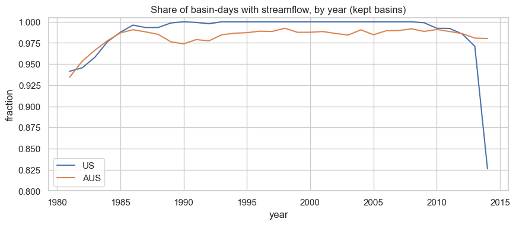
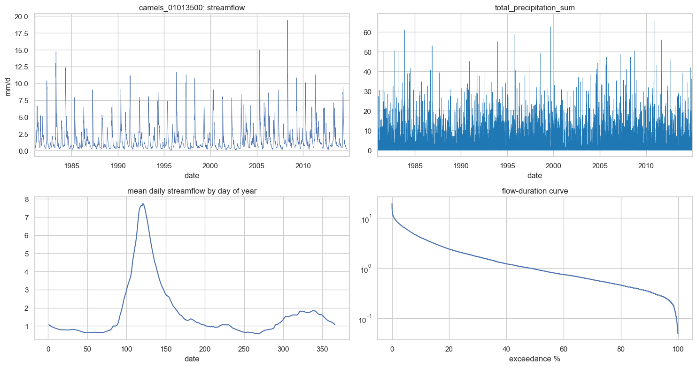

# Preliminary Results

To preface, we have only begun exploratory data analysis following the finalization of our analysis plan, updated with the feasibility review from Professor Chiang. With the decision made to exclude the water basins out of Great Britain, our training and test data will be drawn from the following regions:

- `camels`, a database of 671 US water basins, of which 631 contain sufficient data
- `camelsaus`, a database of 561 Australian water basins, of which 541 contain sufficient data

Below is a map of the basins available in the two databases.

{#fig:basin-map width=100%}

To arrive at the set of water basins with sufficient data we applied the following thresholds:

-  At least 15 years of valid water flow data.
-  At most 15% of missing window days.

The following figures provide comparisons of the two databases.

{#fig:region-comparison width=100%}

Below we dril down into the availability of streamflow data over time, from the early 1980s to the mid 2010s.

{#fig:missingness-by-year width=100%}

To get an idea of the data present for each basin, we zoom in below on a single basin.

{#fig:example-basin width=100%}

Note the seasonal spikes ~120 days into the year where waterflow rises following spring precipitation. Our immediate next steps are to define the temporal split of our training and test data, and the locational blocking of our water basins, to inform k-fold validation.